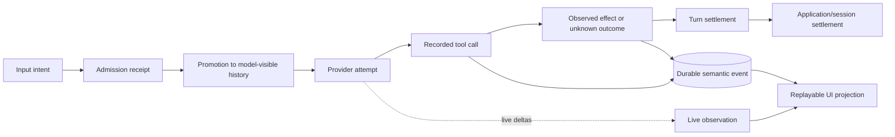

# Bernstein TUI Implementation Plan

Status: initial implementation checkpoint reached; product development continues

Related design: [Bernstein TUI](ftxui-spike.md)

Results checkpoint: [Bernstein TUI results and decision checkpoint](tui-results.md)

## Plan revision after Pi/OpenCode analysis

Before implementation, this plan was revised using supplied analyses of Pi and OpenCode:

- Pi architecture analysis
- OpenCode architecture analysis
- Pi versus OpenCode comparison

These analyses are not published with this repository.

The original plan's `AgentSession::snapshot()` abstraction was too coarse for the lifecycle boundaries Bernstein cares about. The spike must now distinguish:



This is the first product implementation slice. The initial state is deterministic and in memory so the contracts can be made explicit before persistence and real execution are added. The records are not disposable demo state; they are the first reference model for the product's lifecycle semantics.

The implementation order remains eleven stacked changes, but step 1 is now explicitly a lifecycle-contract slice and step 2 must test failure boundaries before FTXUI is introduced.

## Outcome

Build a small, deterministic FTXUI prototype that demonstrates Bernstein's intended TUI boundary:

```text
FTXUI input/rendering
  -> typed user intent
  -> terminal-independent session facade
  -> immutable UI projection
  -> FTXUI rendering
```

The prototype will use fake project, evidence, proposal, operation, and verification data. It will not connect to models, edit the workspace, execute commands, or make authorization decisions.

The implementation should end with enough evidence to recommend one of:

- adopt FTXUI for the first production TUI;
- continue the spike against a named unresolved question;
- switch to another terminal library;
- defer a full-screen TUI.

## Working assumptions

- The current C++ executable remains intentionally small while the spike is developed.
- `bernstein-core` must remain independent of FTXUI and terminal APIs.
- CLI11 remains the batch/headless command-line boundary.
- The fake session is a test fixture and architectural probe, not a replacement for the future project model.
- No permanent product decision is implied by a passing prototype.
- The existing uncommitted files are unrelated unless explicitly selected for the change.

## Proposed target and file layout

Prefer a separate application target so the TUI dependency cannot leak into core libraries:

```text
apps/
  CMakeLists.txt
  bernstein-agent/
    CMakeLists.txt
    main.cpp                    # existing/headless entry point
  bernstein-agent-tui/
    CMakeLists.txt
    main.cpp                    # FTXUI startup and terminal lifetime
    tui_app.hpp/.cpp             # component composition and event routing
    tui_view.hpp/.cpp            # projection-to-element rendering

libs/bernstein-core/
  CMakeLists.txt
  include/bernstein/core/
    session.hpp                  # terminal-independent facade contract
    lifecycle.hpp                # input, operation, event, and outcome types
    ui_projection.hpp            # immutable display projection
  src/
    session.cpp                  # facade and deterministic fake implementation
    fake_state.cpp               # only if fake data belongs in the library

tests/
  CMakeLists.txt
  bernstein-core/
    session_tests.cpp
  bernstein-agent-tui/
    tui_event_tests.cpp
    tui_render_tests.cpp         # if the selected seam supports this cleanly

docs/
  ftxui-spike.md
  ftxui-spike-implementation-plan.md
  tui-results.md                 # results and decision record
```

The exact split may change after the first compile. The invariant is that core headers contain no FTXUI types, terminal handles, component objects, or rendering concerns.

## Phase 0 — Establish the change boundary

### Tasks

1. Inspect the current Jujutsu working copy and identify unrelated changes.
2. Keep the spike implementation and its dependency changes in a separate change set.
3. Confirm the current remote base before adding implementation files.
4. Do not stage, commit, or alter unrelated files.

### Exit condition

The implementation can be reviewed independently from `.idea/workspace.xml`, `AGENTS.md`, user-complaint notes, and other existing work.

## Phase 1 — Add and pin FTXUI

### Tasks

1. Choose the exact FTXUI revision to evaluate.
2. Confirm whether the project should use the Conan package or a pinned CMake source dependency.
3. Prefer the smallest dependency surface initially: use `screen`, `dom`, and `component` only if the selected integration exposes those targets cleanly.
4. Add an opt-in CMake target for the TUI prototype.
5. Keep the normal core/headless build working when the TUI target is disabled or unavailable.
6. Record the selected revision, package recipe/source, compiler, platform, and build configuration.

### Design constraints

- Do not add FTXUI to `bernstein-core`.
- Do not use an unpinned “latest” dependency.
- Do not modify the global development installation as part of the spike.
- Do not make the full project depend on a terminal being present during tests.

### Verification

- Configure the project with the TUI enabled.
- Build the new target.
- Configure and build with the TUI disabled, if the integration supports an option.
- Confirm the existing headless executable still builds.

## Phase 2 — Define the terminal-independent session and lifecycle contract

This phase is broader than the original snapshot contract. It must establish the smallest useful distinction between admitted input, visible history, execution ownership, live observation, durable semantic state, and completion.

### Tasks

1. Define identifiers for the fake workspace, session, input, module, evidence item, proposal, candidate, operation, execution attempt, observation, and durable event.
2. Define typed intent variants for admission, selection, inspection, approval request, cancellation, reconciliation, and quit.
3. Define an input receipt separate from an assistant answer or execution completion.
4. Define promotion from accepted input to model-visible history as a separate fixture transition.
5. Define operation and execution-attempt records distinct from the process-local fake driver.
6. Define live observations separately from durable semantic events and replay cursors.
7. Define an immutable `UiProjection` containing only displayable, scoped data.
8. Define how invalid, stale, missing, unsupported, interrupted, and unknown outcomes are represented.
9. Define a deterministic event/update mechanism for simulated long-running operations and reconnect.

### Minimum intent set

```text
SubmitInput
SelectProject
SelectModule
SelectEvidence
InspectProposal
InspectCandidate
RequestApproval
CancelOperation
OpenDiff
ReconcileOperation
Quit
```

Each intent should carry typed identifiers or parameters. Avoid stringly-typed command names where a domain variant is practical.

### Minimum state set

```text
Input: Accepted -> Promoted -> Rejected | Conflict
Operation: Pending -> Running -> Interrupted | Unknown | Settled
Effect: Intended -> Recorded -> Observed | Unknown
Proposal: Proposed -> RequiresApproval -> Admitted
Verification: Unverified -> Verified | CoverageGap
```

The fake session must not transition directly from an accepted input to a verified result without representing the intermediate promotion, operation, effect, evidence, and settlement states in the projection or event history.

### Verification

Write session transition tests before connecting FTXUI. At minimum, test:

- selecting an item changes only selection state;
- admitting an input returns an input receipt and does not claim an assistant response;
- promoting an input is visible as a distinct transition;
- inspecting a proposal exposes evidence, assumptions, obligations, and uncertainty;
- requesting approval produces a typed intent and an explicit state transition;
- a process-local execution pass can disappear while the durable operation remains inspectable;
- live deltas are not silently presented as durable replayable events;
- cancellation does not claim that a dispatched external operation was cancelled;
- timeout after dispatch produces `Unknown` or an explicit reconciliation state;
- reconnect replays durable semantic state without replaying the fake effect;
- stale or missing evidence cannot appear as successful verification;
- equivalent headless and TUI actions produce the same intent type.

## Phase 3 — Build the FTXUI adapter

### Tasks

1. Create the FTXUI application lifetime and terminal restoration path.
2. Subscribe the UI to the session's immutable projection and explicitly labelled live observations.
3. Translate keyboard and mouse events into typed `UserIntent` values.
4. Render the projection into a stable layout.
5. Keep focus, selection, transient input, and layout state local to the UI adapter.
6. Add explicit handling for quit, interrupt, resize, and terminal-too-small conditions.
7. Keep long-running simulated updates from blocking input handling.

### Initial views

Implement only the views needed to exercise the contract:

```text
Header/status
  workspace, branch, current operation, mode

Navigation pane
  projects, modules, evidence, proposals, candidates

Main pane
  topology/evidence, proposal, candidate diff, or verification details

Activity pane
  simulated lifecycle events, findings, and reconciliation status

Footer
  key hints, pending approval, uncertainty, and diagnostics
```

The view should favor explicit status and provenance over conversational polish.

### Rendering rules

- Do not render `Unknown` as success, blank data, or a green completion indicator.
- Show the identity/scope of the selected artifact or evidence item.
- Show whether a displayed action is proposed, awaiting approval, admitted, dispatched, observed, verified, or unresolved.
- Show whether an item is an admission receipt, a promoted input, a live-only observation, a durable event, or a settled outcome.
- Keep approval controls visually distinct from ordinary navigation.
- Make it impossible for a display callback to acquire an effect capability.

### Verification

- Drive representative event sequences through the adapter.
- Verify that selection, inspection, approval request, cancellation, and reconciliation are visible.
- Verify that resize and small-terminal paths do not crash or silently hide the current state.
- Verify terminal restoration on normal quit and handled interrupt.

## Phase 4 — Add deterministic UI test seams

### Tasks

1. Identify the smallest stable seam for testing component event handling.
2. Prefer tests that feed controlled events and inspect resulting intents/state.
3. If practical, render fixed snapshots to a deterministic text representation.
4. Avoid tests that depend on a real user's terminal dimensions, color profile, or timing.
5. Add a test for an asynchronous-looking update sequence using a deterministic fake clock or event queue.

### Required test categories

| Category | Evidence required |
| --- | --- |
| Session/lifecycle transitions | Receipt, promotion, operation, event, and projection assertions without FTXUI |
| Event translation | Controlled key/mouse event produces expected typed intent |
| Rendering | Stable representation or narrowly scoped component assertion |
| Lifecycle | Quit/interruption restores terminal state under the supported test seam |
| Small terminal | Explicit fallback/diagnostic state |
| Unknown handling | Timeout/stale/missing evidence remains visibly unresolved |
| Replay separation | Durable projection replay does not invoke an effect |
| Headless parity | Same session contract works without terminal initialization |

If FTXUI does not provide a clean deterministic rendering seam, record that as an evaluation result rather than building a large custom testing framework during the spike.

## Phase 5 — Exercise the prototype manually

### Scenarios

Run each scenario from a clean fake-session state and record the observed result:

1. Start in headless mode.
2. Start the TUI with a fake workspace.
3. Navigate from workspace to module to evidence.
4. Inspect a proposal with explicit assumptions and obligations.
5. Request approval and verify that no effect occurs.
6. Start a simulated operation and observe lifecycle updates.
7. Simulate dispatch followed by timeout; confirm unresolved status.
8. Request reconciliation; confirm that the UI does not invent a backend result.
9. Resize to a small terminal.
10. Interrupt during a running simulated operation.
11. Exit and confirm the shell terminal is restored.

### Environments

Record at least the development terminal used for the spike. If practical, repeat in another terminal or multiplexer session. Record:

- operating system;
- terminal emulator and version;
- `$TERM` value;
- locale/UTF-8 behavior;
- terminal dimensions used;
- color capability observed;
- multiplexer presence, if any.

This is an environment sample, not complete portability verification.

## Phase 6 — Capture results and make the decision

Create `docs/tui-results.md` containing:

- exact repository snapshot and Jujutsu change id;
- exact FTXUI revision and dependency integration;
- commands used;
- target/platform/compiler versions;
- tests run and their scope;
- manual scenarios completed;
- terminal environments exercised;
- screenshots or text captures where useful;
- boundary violations or design friction discovered;
- performance or responsiveness observations, without unsupported generalization;
- known coverage gaps;
- recommendation and rationale;
- alternatives rejected or retained;
- human decisions still required.

The result must distinguish compilation, selected tests, manual interaction, and portability observations. None alone establishes complete workflow correctness or terminal portability.

## Suggested implementation order

The safest order is:

1. lifecycle contracts, projections, and deterministic fake state;
2. lifecycle transition and failure-boundary tests;
3. FTXUI dependency and minimal screen target;
4. read-only projection renderer;
5. event-to-intent translation;
6. simulated lifecycle updates, receipts, and replay cursors;
7. resize, interrupt, and small-terminal behavior;
8. deterministic UI tests;
9. headless parity check;
10. manual scenarios;
11. results document and decision checkpoint.

This order keeps the core contract testable before UI details make the design expensive to change.

## Risks and mitigations

| Risk | Mitigation |
| --- | --- |
| FTXUI types leak into core | Enforce target dependency direction and inspect include/dependency graphs. |
| UI callbacks acquire authority | Expose only typed intents; keep admission and effects behind the session/application facade. |
| Asynchronous updates block input | Use a controlled update queue and bounded UI-thread work. |
| Tests depend on a real terminal | Test session transitions independently and use controlled event/render seams. |
| Unknown becomes visually indistinguishable from failure or success | Define explicit status styling and assertions for unresolved states. |
| Terminal is left in raw/alternate-screen mode | Centralize lifetime handling and test normal/interrupt paths. |
| Dependency packaging is unstable | Pin an exact revision and record the source/package configuration. |
| Prototype turns into a permanent UI framework | Limit fake data and widgets to the spike acceptance criteria. |
| Manual demo hides architectural flaws | Require headless parity and boundary-focused tests before acceptance. |
| Input receipt is mistaken for completion | Display and test admission, promotion, turn settlement, and operation settlement separately. |
| Live event is mistaken for durable history | Carry event durability/replay metadata into the projection and exercise reconnect. |
| Durable projection is mistaken for effect replay | Make replay tests assert that the fake effect is not invoked a second time. |
| Process-local runner is mistaken for durable ownership | Model driver lifetime and operation state as separate values. |
| Concurrent tool execution is added accidentally | Start with a defined completed-assistant/batch boundary and make overlap a later decision. |
| Existing WIP is accidentally included | Use path-scoped change operations and verify the final Jujutsu diff. |

## Definition of done

The spike implementation is ready for review when:

- the prototype builds from the recorded setup;
- core/session tests pass without a terminal;
- lifecycle tests cover admission, promotion, operation ownership, live-versus-durable events, unknown outcomes, and replay without effect re-execution;
- the TUI demonstrates the minimum receipt, navigation, inspection, approval-request, operation, timeout, reconciliation, resize, and quit flows;
- no real effects are possible from the fake prototype;
- the UI and core dependency boundary is visible in the build and source layout;
- the headless path remains usable;
- terminal restoration and small-terminal behavior have evidence;
- the selected UI test seam is documented, including limitations;
- the result document records exact commands, versions, scope, and gaps;
- the maintainers have an explicit adopt/continue/switch/defer decision.

## Follow-up after the spike

Only after the decision checkpoint should the project consider:

- connecting the TUI to real project/evidence state;
- adding model proposal streams;
- integrating LSP or tool status;
- implementing real approval/admission flows;
- rendering real diffs and verification evidence;
- persisting operation lifecycle state;
- adding richer navigation, search, command palette, or customization;
- evaluating alternative terminal backends for portability or graphics.
