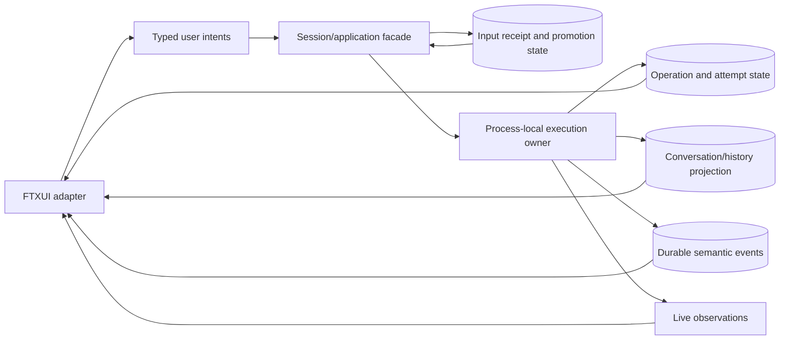

# Bernstein TUI

Status: active implementation plan

Owner: Bernstein maintainers

## Revision after Pi/OpenCode analysis

This implementation plan was revised after reviewing the supplied architectural analyses of Pi and OpenCode in `/Users/marcossantos/code/pi/docs`:

- [Pi architecture analysis](/Users/marcossantos/code/pi/docs/architecture-analysis.md)
- [OpenCode architecture analysis](/Users/marcossantos/code/pi/docs/opencode-architecture-analysis.md)
- [Pi versus OpenCode comparison](/Users/marcossantos/code/pi/docs/pi-vs-opencode-architecture.md)

Those documents analyze pinned local snapshots and distinguish observed implementation from architectural inference. They are not evidence that Bernstein should copy either product. They do expose boundaries that the original FTXUI proposal made too coarse.

The revised implementation treats the TUI as a client of explicit projections and lifecycle records, not as a direct view over one mutable `AgentSession` object.



Revised design consequences:

1. An accepted input receipt is not an assistant answer and is not proof that execution started.
2. Input admission and model-visible promotion are separate lifecycle points.
3. A durable operation/execution record is distinct from the process-local worker currently driving it.
4. A live delta is not automatically a durable event and may not be replayable after reconnect.
5. A durable event may be replayed for projection without re-running an external effect.
6. Provider completion, tool settlement, application settlement, and operation completion are distinct boundaries.
7. The first fake implementation must exercise unknown outcomes and recovery states, not only successful navigation.

FTXUI remains the selected first UI technology in this implementation plan. The implementation must still record where the library helps or constrains the architecture, but the work is product development, not a throwaway demo.

## Purpose

Evaluate FTXUI as the presentation layer for Bernstein's first interactive terminal user interface.

The spike is intended to answer a bounded engineering question:

> Can Bernstein provide a useful, testable, architecture-aware terminal workflow with FTXUI while keeping project state, authority, effects, verification, and audit outside the UI layer?

This document proposes an experiment. It does not adopt FTXUI as a permanent dependency or approve a final product interaction model.

## Context

Bernstein is an architecture-aware coding agent. Its planned workflow includes:

1. exploring project evidence and topology;
2. discussing a goal and design alternatives;
3. approving a bounded scope;
4. producing a candidate change;
5. verifying the exact candidate and relevant obligations;
6. reviewing uncertainty and publishing or revising the result.

The TUI must make these distinctions visible. In particular, a plausible model proposal, an approved proposal, an admitted action, an observed effect, and a verified result are different states and must not be collapsed into a generic conversational transcript.

The current executable is an intentionally empty shell. The repository already has CMake/Conan infrastructure, CLI11 for command-line parsing, and Catch2 for tests. The spike should build on that foundation while keeping FTXUI isolated from the core libraries.

## Provisional architectural position

Use FTXUI for the first TUI prototype, pinned to an exact reviewed revision if the spike succeeds.

The TUI is a presentation and intent-routing adapter over a terminal-independent session/application facade. It is not an authority boundary and it must not perform effectful operations directly.

```text
terminal input
  -> FTXUI event/component
  -> typed UserIntent
  -> session/application facade
  -> input/operation/history/event projections
  -> immutable UiProjection
  -> FTXUI rendering
```

The following responsibilities remain outside the TUI:

- selecting and validating project context;
- interpreting model proposals;
- resolving evidence and freshness;
- policy and obligation evaluation;
- approval and admission;
- filesystem, subprocess, LSP, model, and network effects;
- execution containment;
- verification and test selection;
- durable operation lifecycle and audit/reconciliation.

The facade must expose named lifecycle boundaries rather than one generic “done” state:

```text
accepted receipt
  -> promoted input
  -> provider attempt
  -> tool call recorded
  -> effect observed or outcome unknown
  -> turn settled
  -> application/session settled
```

The spike may implement these in memory, but it must preserve their semantic distinction.

An `Allow` result or a button labelled “approve” must not itself be treated as an execution grant. The application/session layer must perform the relevant checks and expose the resulting state back to the UI.

## Spike scope

Implement a fake-session prototype with deterministic in-memory state and no real model, filesystem, subprocess, LSP, or network effects.

The prototype should include:

- a project/module/evidence navigation view;
- a proposal detail view showing goal, evidence, assumptions, obligations, and uncertainty;
- a candidate change or diff view using representative fake data;
- a typed approval interaction that emits an intent but does not execute an effect;
- an input receipt distinct from an assistant response or execution completion;
- a visible distinction between admitted, promoted, live-only, durable, and settled state;
- a streaming operation/status panel driven by simulated lifecycle events;
- a simulated disconnect/reconnect path that replays durable semantic state without replaying effects;
- an interrupted-effect/unknown-outcome state;
- terminal resize handling;
- small-terminal degradation or a clear diagnostic state;
- escape/cancellation handling;
- a headless path that exercises the same session facade without initializing FTXUI.

The prototype should be useful enough to expose whether the workflow is understandable, but it should not attempt to implement the full coding agent.

## Explicit non-goals

The spike will not:

- connect to a model provider;
- edit the user's workspace;
- launch repository commands;
- implement sandboxing or capability enforcement;
- decide which tests are sufficient;
- persist project state or audit events;
- define the final Bernstein visual design;
- introduce a general widget framework owned by Bernstein;
- support images, video, Sixel, Kitty graphics, or other terminal multimedia;
- replace CLI11 or remove batch/headless operation;
- establish that FTXUI is portable across every terminal Bernstein may eventually support.

## Candidate contracts

The exact names may change during implementation, but the dependency direction and lifecycle distinctions should remain stable.

```cpp
struct InputReceipt {
    InputId id;
    SessionId session;
    DeliveryMode delivery;
    ReceiptStatus status; // accepted, promoted, rejected, or conflict
};

struct OperationView {
    OperationId id;
    InputId input;
    OperationStatus status; // pending, running, interrupted, unknown, settled
    std::optional<ExecutionAttemptId> active_attempt;
};

struct LiveObservation {
    ObservationId id;
    std::optional<OperationId> operation;
    std::string kind;
    std::string detail;
};

struct DurableEventCursor {
    std::uint64_t sequence;
};

struct UiProjection {
    // Immutable display projection assembled from current session state.
    // It combines history, input, operation, durable-event, and live views
    // without exposing effect handles or credentials.
};

enum class UserIntentKind {
    SubmitInput,
    SelectProject,
    SelectEvidence,
    InspectProposal,
    InspectCandidate,
    RequestApproval,
    CancelOperation,
    ReconcileOperation,
    OpenDiff,
    Quit,
};

struct UserIntent {
    UserIntentKind kind;
    // Typed identifiers and parameters appropriate to the intent.
};

class SessionFacade {
public:
    InputReceipt admit(UserIntent intent);
    [[nodiscard]] UiProjection projection() const;
    [[nodiscard]] std::vector<LiveObservation> live_observations() const;
    [[nodiscard]] std::vector<DurableEventCursor> durable_cursors() const;
    void dispatch_control(UserIntent intent);
};
```

The names above are contract sketches, not a final public API. In particular:

- `InputReceipt` acknowledges admission only;
- `UiProjection` is not the authoritative store;
- a durable cursor is not a guarantee that every live delta is replayable;
- `OperationView` does not claim that an external effect is exactly-once;
- `ReconcileOperation` must not invent an outcome that was not observed.

The FTXUI layer may own focus, selection, transient input, and layout state. It must not become the owner of durable project state or authority-bearing decisions.

## Proposed screen model

```text
┌─────────────────────────────────────────────────────────────┐
│ Workspace / branch / operation status                       │
├───────────────┬───────────────────────────────┬─────────────┤
│ Project       │ Evidence / topology / diff     │ Details     │
│ navigation    │                               │             │
├───────────────┴───────────────────────────────┴─────────────┤
│ Conversation, proposal, findings, or verification stream    │
├─────────────────────────────────────────────────────────────┤
│ Mode / pending approval / uncertainty / key hints            │
└─────────────────────────────────────────────────────────────┘
```

The layout is illustrative. The spike should prioritize state clarity and interaction boundaries over visual polish.

The details view should be able to distinguish at least:

| State | Meaning |
| --- | --- |
| Proposed | A model or user candidate exists; it is not approved or executed. |
| Requires approval | A declared human decision is needed before the next transition. |
| Admitted | The application accepted a specific action under current state and obligations. |
| Dispatched | The effect was handed to an executor; completion is not yet known. |
| Observed | An executor/backend reported an outcome with provenance. |
| Verified | Declared checks completed for the exact artifact and scope. |
| Unknown | Evidence, coverage, or outcome is incomplete and cannot authorize a stronger claim. |

## Acceptance criteria

The spike is successful only if all of the following are demonstrated:

### Boundary and authority

- FTXUI code emits typed intents rather than invoking tools or effects.
- The session/application facade is usable without a terminal.
- Input admission returns a receipt without claiming assistant completion.
- Promotion to model-visible history is distinct from admission.
- Process-local execution ownership is distinct from durable operation state.
- No UI label, callback, or component state is treated as approval authority.
- Credentials, raw process handles, and unmediated effect capabilities are absent from `UiProjection`.
- The headless and TUI paths dispatch the same intent types for equivalent actions.

### State and evidence

- The UI can display the difference between proposal, approval, admission, dispatch, observation, verification, and unknown.
- Evidence references include enough identity/version information in the fake model to show that a result is scoped to an artifact or workspace snapshot.
- Missing or stale evidence is rendered as a coverage/uncertainty state, not as a successful empty result.
- A simulated timeout after dispatch remains distinguishable from a confirmed failure or cancellation.
- Live observations are distinguishable from durable replayable events.
- Replaying durable state does not re-run a simulated external effect.
- Provider, turn, application, and operation settlement are not collapsed into one completion flag.

### Interaction

- A user can navigate the fake project/evidence hierarchy.
- A user can inspect a proposal and its assumptions/obligations.
- A user can request approval and see the resulting typed intent/state transition.
- A user can cancel a simulated operation without implying that an already-dispatched external effect was cancelled.
- The interface remains usable after resize, interruption, and return from a transient view.

### Testability and operations

- Session transition tests run without a real terminal.
- Rendering or component tests have a deterministic test seam, such as a stable snapshot or controlled event sequence.
- The application exits with the terminal restored after normal quit and handled interruption.
- A noninteractive invocation remains available for CI and scripted diagnostics.
- The exact FTXUI revision and build configuration are recorded with the spike result.

### Usability signal

- A reviewer can identify the current workspace, selected object, pending decision, and uncertainty without reading implementation details.
- The reviewer can tell whether an action is merely proposed, awaiting approval, running, complete, or unresolved.
- The layout has an intentional response for terminals too small to show the full view.

## Evaluation questions

The spike should record evidence for these questions rather than relying on framework reputation or aesthetic preference:

1. Does FTXUI's component/event model remain understandable when session updates arrive asynchronously?
2. Can the UI render immutable snapshots without coupling the core model to FTXUI types?
3. Can long-running status updates avoid blocking input and cancellation?
4. Can rendering and interaction behavior be tested deterministically in CI?
5. What terminal, locale, Unicode-width, color, and resize behavior needs explicit handling?
6. How does the application recover when the terminal is interrupted or the process exits unexpectedly?
7. Does the dependency integrate cleanly with the current Conan/CMake setup, or is a pinned source dependency preferable?
8. What functionality would be lost in headless mode, and is that loss acceptable?
9. Does the UI encourage users to understand and review proposals, evidence, and uncertainty rather than merely accept conversational output?
10. What, if anything, would justify choosing ncursesw, CPP-Terminal, or Notcurses instead?
11. Which lifecycle records must be durable for Bernstein's first local-agent restart promise, if any?
12. Which event categories are semantic and replayable, and which are deliberately live-only?
13. Is completed-assistant batch execution the right first tool-start boundary, or is concurrent stream/tool work worth the recovery cost?

## Implementation shape

Keep the dependency isolated in a UI-specific target. A possible initial structure is:

```text
libs/bernstein-core/
  session/application contracts, input lifecycle, projections, and domain state

apps/bernstein-agent/
  CLI11 dispatch and batch/headless entry point

apps/bernstein-agent-tui/
  FTXUI adapter, interactive entry point, and projection/event subscriptions
```

If a separate executable would duplicate too much startup code, the TUI may initially be an optional target or mode of `bernstein-agent`, but `bernstein-core` must not include FTXUI headers or types.

Use an exact dependency revision. Do not rely on an unpinned “latest” package. The upstream repository currently advertises FTXUI 7.0.3 and recommends pinning a specific CMake revision; hosted documentation may not match the repository version, so the selected revision must be built and recorded as part of the spike evidence.

## Verification record

The completed spike should produce a short record containing:

- exact repository/workspace snapshot;
- exact FTXUI revision and package/build configuration;
- supported compiler and platform used;
- commands used to build and run the prototype;
- tests and deterministic rendering/event checks executed;
- terminal environments exercised;
- known coverage gaps and unsupported terminal behavior;
- observed architectural boundary violations, if any;
- recommendation: adopt, revise, defer, or reject;
- unresolved decisions requiring human approval.

The record must not claim complete UI portability or complete workflow verification from a single terminal session. A passing prototype demonstrates only the exercised behavior under the recorded environment.

## Alternatives retained

### ncursesw

Retain as the portability-oriented fallback. It is a mature character-cell terminal API with terminfo support and wide-character configuration. It becomes preferable if deployment on restricted or unusually old terminals is a primary requirement, or if FTXUI's abstraction prevents the required control.

### CPP-Terminal

Retain as the small terminal-control option if Bernstein chooses to own its own layout and widget abstractions. It may reduce dependency surface but increases the amount of UI infrastructure Bernstein must design and test.

### Notcurses

Retain for a later graphics-rich evidence/topology experiment. Its Unicode, color, plane, and terminal-graphics capabilities are not required for this first text-oriented spike.

## Decision checkpoint

After the spike, maintainers should explicitly choose one of:

- **Adopt FTXUI for the first production TUI**, with a versioning and terminal-support policy.
- **Continue the experiment**, naming the unresolved technical question and bounded next test.
- **Switch to ncursesw, CPP-Terminal, or Notcurses**, naming the requirement that drove the change.
- **Defer a full-screen TUI**, retaining CLI11 and implementing a smaller interactive surface first.

The decision should include affected modules, consequences, rejected alternatives, required follow-up work, and remaining uncertainty.

## References

- [FTXUI repository](https://github.com/ArthurSonzogni/FTXUI)
- [FTXUI getting started](https://github.com/ArthurSonzogni/FTXUI/blob/main/doc/getting-started.md)
- [FTXUI API documentation](https://www.arthursonzogni.com/FTXUI/doc/)
- [ncurses introduction](https://www.invisible-island.net/ncurses/ncurses-intro.html)
- [ncurses FAQ](https://invisible-island.net/ncurses/ncurses.faq.html)
- [Notcurses repository](https://github.com/dankamongmen/notcurses)
- [Notcurses manual](https://notcurses.com/notcurses.3.html)
- [CPP-Terminal repository](https://github.com/jupyter-xeus/cpp-terminal)
- [Pi architecture analysis](/Users/marcossantos/code/pi/docs/architecture-analysis.md)
- [OpenCode architecture analysis](/Users/marcossantos/code/pi/docs/opencode-architecture-analysis.md)
- [Pi versus OpenCode comparison](/Users/marcossantos/code/pi/docs/pi-vs-opencode-architecture.md)
