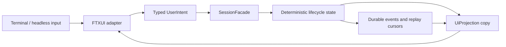

# Bernstein TUI results and decision checkpoint

Status: initial implementation checkpoint reached

## Decision

Continue with FTXUI as Bernstein’s first product TUI technology and continue development against the current projection/intent architecture.

This is a technology and boundary decision, not a claim that the current visual design is finished. The implementation has enough evidence to continue product development with FTXUI, while the interaction details and lifecycle views remain subject to review.

## What was established

The stack now demonstrates:

- a terminal-independent lifecycle model;
- separate admission, promotion, operation, attempt, observation, durable-event, and replay concepts;
- a read-only projection boundary;
- a stateless projection-to-FTXUI Adapter;
- a familiar coding-agent layout with header, conversation, composer, and status/footer regions;
- pure event-to-intent translation;
- deterministic lifecycle simulation and cursor receipts;
- fullscreen interactive application ownership through FTXUI;
- fixed-screen deterministic rendering tests;
- a headless snapshot path using the same renderer;
- documented manual checks for resize, narrow terminals, interrupt, and restoration.

## Evidence summary

| Area | Evidence | Result | Boundary |
| --- | --- | --- | --- |
| Core lifecycle | Catch2 session tests | 8/8 passed | In-memory fake only |
| Event translation | Deterministic TUI test | Passed | No live terminal |
| Projection rendering | Fixed-size FTXUI screen test | Passed | No terminal resize signal |
| Headless parity | Shared-renderer equality test | Passed | Same process and renderer |
| Build integration | CMake/Conan target | Passed | macOS arm64/C++23 environment |
| Interactive loop | FTXUI fullscreen app compiles | Passed | Live manual execution required |
| Resize and restoration | Manual scenario checklist | Not automated | Human review required |

The automated suite currently reports 11 passing tests. This establishes deterministic behavior for the declared fake state and renderer seams; it does not establish real model behavior, workspace effects, terminal portability, sandboxing, authorization, verification adequacy, or external outcome reconciliation.

## Trade-offs accepted for the next slice

FTXUI provides the required DOM, screen, component, event, fullscreen, and headless-rendering primitives with a small dependency surface. Its component/event model is sufficient for the current coding-agent metaphor and does not force Bernstein core to depend on terminal types.

The current implementation intentionally leaves several product questions open:

- how conversation history, proposals, operations, evidence, and approval details divide between primary and detail views;
- how a truly narrow terminal presents state without misleading omission;
- how live observations and durable events are visually distinguished during active work;
- how simulated updates are scheduled without blocking input;
- how real model/provider and workspace adapters will populate the lifecycle records;
- whether later terminal portability work exposes FTXUI limitations.

## Review checkpoint

The next product review should decide:

1. whether the header/conversation/composer metaphor is the right primary interaction surface;
2. which Bernstein-specific state deserves persistent visibility;
3. which detail views are required before real model integration;
4. the minimum supported terminal dimensions and degradation behavior;
5. whether the current FTXUI dependency/build arrangement is acceptable for the main development path.

Until those decisions are made, the current layout is a stable implementation seam and a useful test surface, not a final visual specification.

## Related artifacts

- [Bernstein TUI design](ftxui-spike.md)
- [Bernstein TUI implementation plan](ftxui-spike-implementation-plan.md)
- [Manual terminal scenarios](tui-manual-scenarios.md)
- [Private stacked implementation log](../inception/tui-implementation-log.md)
