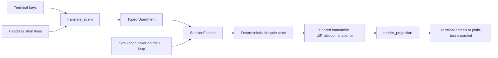

# Bernstein TUI results and decision record

Status: FTXUI adopted; the TUI is the current product priority

## Decision

Decision owner: Bernstein maintainers. Recorded: 2026-09-16.

FTXUI is Bernstein's TUI technology. Development continues against the projection/intent architecture described in [the TUI design](ftxui-spike.md). The ncursesw, CPP-Terminal, and Notcurses alternatives are not being pursued for the first product TUI.

The decision covers the terminal library and the boundary between the TUI and the session. It does not approve a final visual design, and it does not claim terminal portability beyond the environments recorded below.

## Architecture

Targets:

- `bernstein::core`: lifecycle records, `SessionFacade`, `FakeSession`, and status labels. It has no FTXUI dependency.
- `bernstein::tui`: event translation, projection rendering, and the headless driver. Both the executable and the tests link this library.
- `bernstein-agent-tui`: the fullscreen executable and the `--headless` mode.
- `BERNSTEIN_BUILD_TUI` (default `ON`): set it to `OFF` to build core and the existing agent without FTXUI.

## Projection contract

- `SessionFacade::projection()` returns `std::shared_ptr<const UiProjection>`. The session publishes a new snapshot once after each state change, and `projection()` returns the stored pointer without copying session state. Without an intervening change, it returns the same pointer.
- A snapshot holds only the last `durable_event_tail_size` (32) durable events, plus the latest `DurableEventCursor`. The full history is available only through `replay(cursor)`.
- The fullscreen loop takes one snapshot per frame, in the renderer. The next event is translated against that same pointer, so keys act on the state that was displayed.
- `translate_event` receives only the snapshot's operations.

## Current behavior

- **Conversation:** each input shows whether it is accepted or model-visible, plus its operation status, effect status, and detail. The region scrolls so the newest entry stays visible.
- **Unknown outcomes:** they are labelled `operation outcome unknown` and never shown as settled.
- **Activity:** the two most recent durable events show their cursor sequence, and the most recent live observation is labelled `live`.
- **Context:** proposal approval status and candidate verification status are shown.
- **Simulation:** a ticker on the UI loop runs operations one at a time. Each operation is promoted, then starts running, then settles.
- **Keys:** Enter submits. Esc or Ctrl+U clears the draft. Backspace deletes one UTF-8 code point. Ctrl+X cancels the oldest active operation, and Ctrl+R reconciles the newest unknown operation. Ctrl+C quits.
- **Cancellation:** a Pending operation becomes Interrupted with no unknown outcome. A Running operation becomes Unknown. Cancelling an operation that is no longer active only records a live observation.
- **Reconciliation:** it applies only to Unknown operations and never invents an outcome.
- **Approval events:** they carry the proposal identity.
- **Small terminals:** a terminal smaller than 60x20 shows a diagnostic instead of a clipped layout.
- **Headless mode:** `--headless` reads lines from stdin, sends them through the composer event translation, runs the simulation until nothing is active, and prints a plain-text snapshot with no escape sequences.

## Evidence

Environment: macOS 15.6.1 arm64, Apple clang 16.0.0, CMake 4.4.3, Conan 2.32.0, FTXUI 7.0.3 (Conan recipe revision `419319b54532623b32d051ea91b5b53c`), C++23, `dev` preset.

| Area | Evidence | Result | Boundary |
| --- | --- | --- | --- |
| Build | `cmake --build --preset dev` | Passed | This environment only |
| Automated suite | `ctest --preset dev --output-on-failure` | 23/23 passed | In-memory fake session |
| Lifecycle transitions | Catch2 session tests | Passed | Fake state; no persistence |
| Snapshot contract | Pointer identity across unchanged and changed state; bounded tail versus full replay | Passed | Fake session only |
| Key translation | Catch2 TUI tests | Passed | Synthetic FTXUI events |
| Rendering | Fixed-size plain-text render assertions | Passed | Fixed dimensions, no styling assertions |
| Headless parity | Headless run through composer events | Passed | Same process; no terminal |
| Test sensitivity | Reverted the UTF-8 backspace, pending-cancel, and scroll fixes; published a snapshot on a simulation step with no change; removed the tail bound. One change at a time | Each change broke its test | Five changes only |
| Fullscreen loop | Scripted pseudo-terminal run (90x26): typing, backspace, submit, simulated progress, Ctrl+X, Ctrl+C | Expected states appeared; exit status 0; alternate screen entered and left | One scripted run; no visual inspection |
| Resize, narrow terminals, other emulators | [Manual scenarios](tui-manual-scenarios.md) | Not yet executed | Human run required |

## Known gaps

- **Replay:** `replay` is a read-only query. No consumer rebuilds a projection from durable events, so no test can show that replay avoids re-running effects.
- **Unused lifecycle states:** `Rejected`, `Conflict`, `Observed`, and `Admitted`, and the steer/queue delivery difference, are declared but never produced.
- **Navigation and approval:** the TUI has no keys or views for selection, inspection, approval, or diffs.
- **Simulated timeouts:** `simulate_timeout` is exercised only by tests. No key triggers it.
- **Warning flags:** `bernstein_target_warnings` attaches flags as `INTERFACE`. The library's own sources get no warning flags, and only the targets that link it do.
- **Manual scenarios:** they have not yet been run in a human-operated terminal.

## Next review questions

1. Which Bernstein-specific state needs to stay visible, and which belongs in detail views?
2. Which navigation and approval interactions are needed before real model integration?
3. Is 60x20 the right minimum terminal size?
4. How should real provider and workspace adapters fill the lifecycle records?

## Related artifacts

- [Bernstein TUI design](ftxui-spike.md)
- [Bernstein TUI implementation plan](ftxui-spike-implementation-plan.md)
- [Manual terminal scenarios](tui-manual-scenarios.md)
